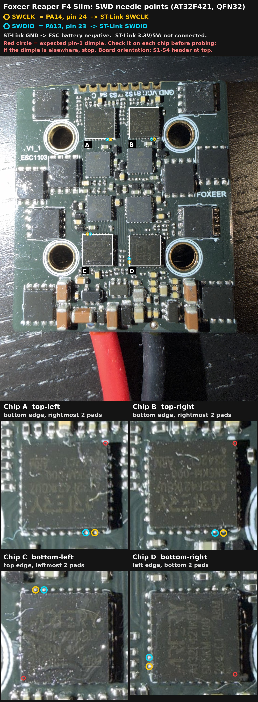

# Foxeer Reaper F4 Slim Mini 60A: BLHeli_32 to AM32

How to convert the **Foxeer Reaper F4 Slim Mini 128K 60A 4-in-1 ESC (BL32 version, MR1682, board marking `ESC1103 V1_1`)** from BLHeli_32 to [AM32](https://github.com/am32-firmware/AM32). Everything you need is in this repo.

> **Status: tested.** This procedure has been used to convert 6 of these boards to AM32. Still check the pin-1 dimple on every chip before you probe, because a board revision could differ. If something doesn't match, please open an issue.

> **Warning:** the conversion is effectively irreversible, and a slipped needle on a powered board can kill the ESC. You do this at your own risk.

## Why

The stock firmware is `FOXEER_ReaperM4IN1_F4_60A_128_Multi_32_9` (BLHeli_32 32.9). This version has the known stuck-motor bug: after a crash or turtle mode, a motor stays dead or squeals until you unplug the battery ([bitdump/BLHeli#697](https://github.com/bitdump/BLHeli/issues/697)). No BLHeli setting reliably fixes it. Betaflight lists 32.8 to 32.10 as not recommended.

## Hardware facts

| | |
|---|---|
| ESC MCUs | 4x Artery **AT32F421K8U7** (QFN32) |
| Gate drivers | 4x Fortior FD6288Q |
| SWD test pads | **none**, so you probe the MCU pins directly |
| SWDIO / SWCLK | PA13 = pin 23 / PA14 = pin 24 |
| ESC signal pin | **PA2** |
| AM32 target | **`FOXEER_F421`** (firmware name `FOXEER F4`) |

These are from the AM32 source, [`Inc/targets.h`](https://github.com/am32-firmware/AM32/blob/main/Inc/targets.h): `FOXEER_F421` uses `HARDWARE_GROUP_AT_C`, which is `MCU_AT421` with its input on `GPIOA` pin 2.

## What's in this repo

| Path | What | Source |
|---|---|---|
| `tools/am32-unlocker/` | AM32 Unlocker v1.0.8 for Windows, macOS and Linux. It removes the BLHeli_32 read protection and installs the AM32 bootloader. | [am32-firmware/AM32-unlocker](https://github.com/am32-firmware/AM32-unlocker/releases/tag/v1.0.8) |
| `tools/zadig/zadig-2.9.exe` | Windows USB driver tool, needed for the ST-Link | [pbatard/libwdi](https://github.com/pbatard/libwdi/releases) / [zadig.akeo.ie](https://zadig.akeo.ie) |
| `firmware/AM32_FOXEER_F421_2.20.hex` | AM32 2.20 for this ESC | [am32-firmware/AM32 v2.20](https://github.com/am32-firmware/AM32/releases/tag/v2.20) |
| `docs/needle-map.jpg` | Where to put the needles on each of the 4 MCUs | this repo |
| `SHA256SUMS` | Checksums of the bundled binaries | |

All bundled tools are unmodified upstream releases under GPL-3.0 (see `third_party-licenses/`). Check upstream for newer versions.

## You also need

- An **ST-Link V2** (a cheap clone works). CMSIS-DAP and J-Link also work with the unlocker.
- Two fine needle probes, ideally mounted so they can't slide, plus a magnifier or microscope.
- A current-limited bench supply, or a LiPo with a smoke stopper.
- A Betaflight flight controller wired to the ESC as normal, and Chrome or Edge for [am32.ca](https://am32.ca).

## Needle map

The board is oriented with the `T C S4 S3 S2 S1 VCC GND` header at the top and the power leads at the bottom.

| Chip | Where | SWCLK (pin 24) | SWDIO (pin 23) |
|---|---|---|---|
| A, top-left | bottom edge | rightmost pad | 2nd from right |
| B, top-right | bottom edge | rightmost pad | 2nd from right |
| C, bottom-left | top edge | leftmost pad | 2nd from left |
| D, bottom-right | left edge | bottom pad | 2nd from bottom |

How to check it yourself: on Artery parts, pin 1 (the round dimple) is at the **bottom-left when the text is readable**. Pins then run counter-clockwise, so pins 24 and 23 are the **two leftmost pads on the top edge**. On every chip on this board, the SWD pins sit at the corner furthest from that chip's gate driver.

## Step 1: ST-Link driver (Windows)

1. Plug in the ST-Link only.
2. Run `tools/zadig/zadig-2.9.exe` as Administrator, then choose Options > List All Devices.
3. Select the ST-Link **debug** interface, choose **WinUSB**, and click Replace/Install Driver.
4. Replug the ST-Link.

If you skip this, the unlocker shows `libusb_open() failed with LIBUSB_ERROR_NOT_SUPPORTED`.

## Step 2: Unlock and install the bootloader on each MCU

Do this **one MCU at a time, four times**. Remove the props, and preferably disconnect the motors.

| ST-Link | ESC |
|---|---|
| GND | ESC battery negative |
| SWCLK | MCU pin 24 (PA14) |
| SWDIO | MCU pin 23 (PA13) |
| 3.3V / 5V | **not connected** |

1. ESC power off. Connect ST-Link GND to ESC battery negative.
2. Run the unlocker and set:
   - Probe: **ST Link**
   - MCU: **F421**
   - Signal pin: **PA2**
   - Mode: **Unlock**
   - Bootloader: the default **`AM32_F421_BOOTLOADER_PA2_V17.bin`** (not a custom one)
3. Click **Start**. Then power the ESC, and hold the two needles on pins 24 and 23.
4. Wait for **Success** and the tones. Power off and move to the next MCU.

Troubleshooting:
- `init mode failed (unable to connect to the target)` with a target voltage of about 3.3 V means the probe sees power but the needles are off the pads or swapped. Swap SWCLK and SWDIO first, then re-check the pin-1 dimple.
- If all four MCUs fail identically, suspect the orientation, not the chips.

## Step 3: Flash AM32

1. Reconnect the ESC to the flight controller as normal (GND, VBAT, S1 to S4), with props off.
2. Plug the flight controller into USB and power the ESC.
3. Open [am32.ca](https://am32.ca), select the flight controller port, then click **Connect** and **Read**. The Flash firmware button only appears after ESCs are detected.
4. Flash **`FOXEER_F421`**, either release 2.20 or `firmware/AM32_FOXEER_F421_2.20.hex` as a local file, to all 4 ESCs. Don't use WRAITH32, TEKKO32 or generic F421.
5. Power-cycle, then Read again. All 4 should show `FOXEER F4` / AM32.

## Step 4: Check before flying

In Betaflight, with props off: check motor order and direction, enable bidirectional DShot, and confirm RPM telemetry. Start with AM32 default settings.

## Credits

- [AM32](https://github.com/am32-firmware/AM32) and [AM32 Unlocker](https://github.com/am32-firmware/AM32-unlocker) by the AM32 team, GPL-3.0
- [Zadig / libwdi](https://github.com/pbatard/libwdi) by Pete Batard, GPL-3.0
